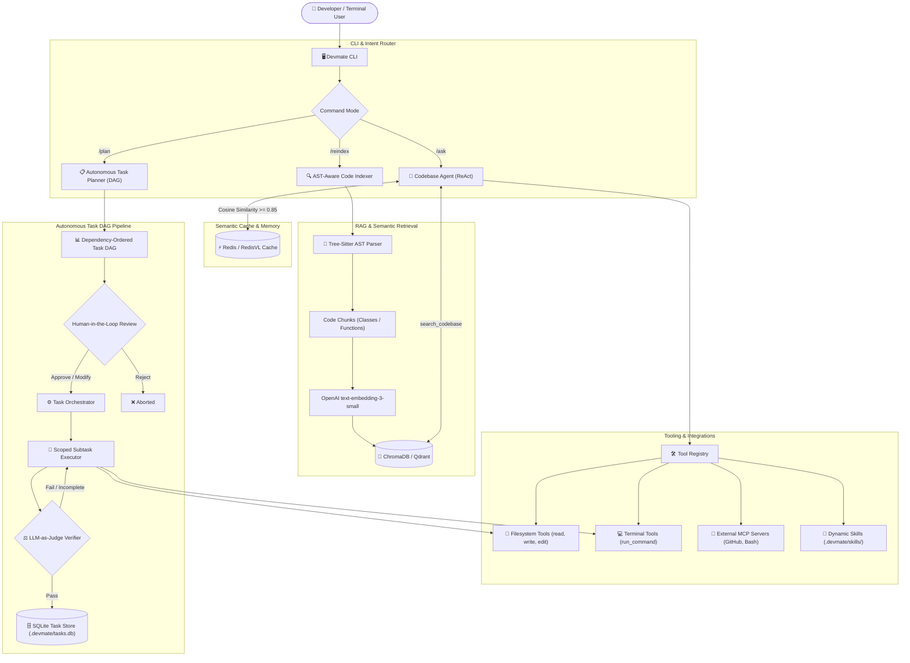
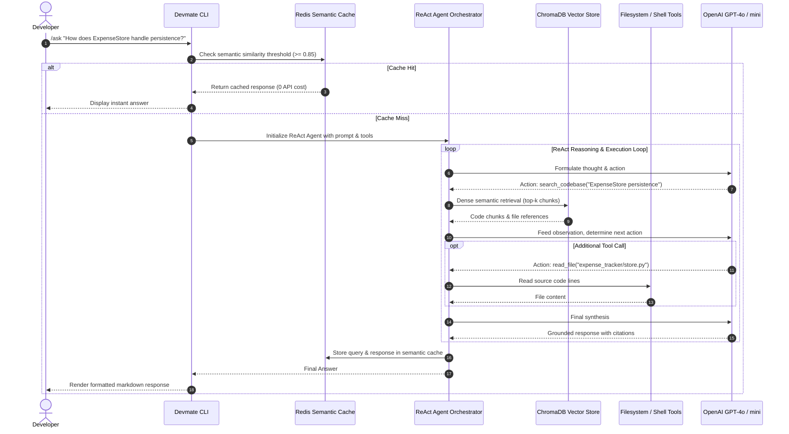
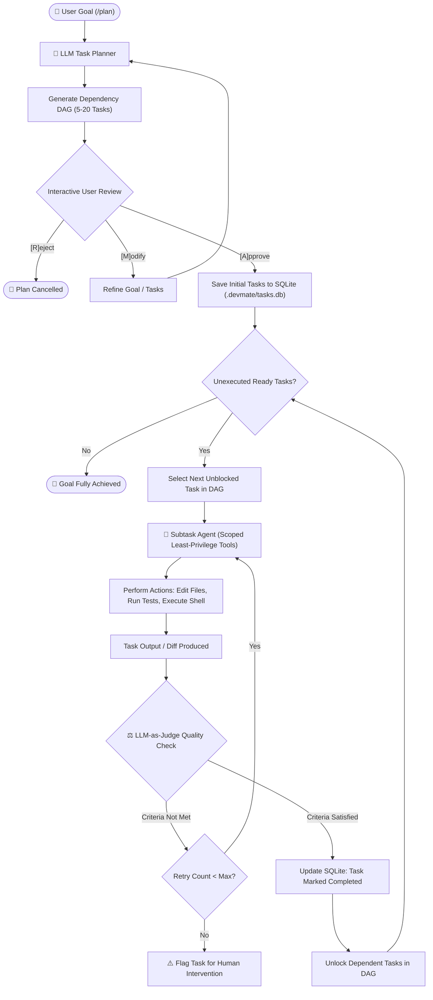
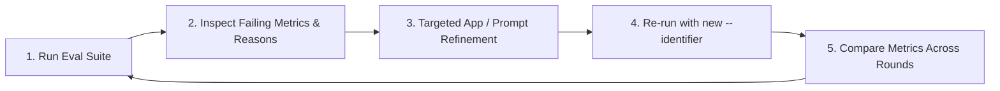

<div align="center">

# Devmate 🤖 (Educosys Claude Code)

### *Autonomous RAG-Powered Coding Agent CLI built on LangChain, LangGraph & DeepEval*

[](https://python.org)
[](https://langchain.com)
[](https://langchain-ai.github.io/langgraph/)
[](https://deepeval.com)
[](https://openai.com)
[](https://trychroma.com)
[](https://qdrant.tech)
[](https://redis.io)
[](https://tree-sitter.github.io)
[](https://modelcontextprotocol.io)
[](https://python-poetry.org)
[](https://pytest.org)
[](https://sqlite.org)
[](LICENSE)

</div>

---

**Devmate** (also known as **Educosys Claude Code**) is an autonomous coding agent CLI (`devmate`) built on **LangChain** and **LangGraph**. Like Claude Code, it is a tool you run *inside another project* (or an empty directory) to get help with that project's code — it is never meant to be pointed at its own source.

It features two distinct agentic surfaces:
- **Codebase Agent (`/ask`)** — a tool-using ReAct-style agent ([devmate/agent/orchestrator.py](devmate/agent/orchestrator.py), [devmate/agent/factory.py](devmate/agent/factory.py)) that answers architectural and implementation questions about whatever repository it is launched in by calling `search_codebase` (RAG over a ChromaDB or Qdrant vector index), `run_command` / `run_in_directory`, external MCP tools, and dynamically loaded skills.
- **Autonomous Task Planner (`/plan`)** — given a software goal, an LLM planner ([devmate/tasks/planner.py](devmate/tasks/planner.py)) produces a dependency-ordered directed acyclic graph (DAG) of subtasks, and a task orchestrator ([devmate/tasks/orchestrator.py](devmate/tasks/orchestrator.py)) dispatches each task to a focused subtask agent ([devmate/tasks/executor.py](devmate/tasks/executor.py)) equipped with a least-privilege toolset (scoped filesystem and terminal tools) to add code, build features, or fix bugs. Every subtask's output is evaluated by an internal LLM-as-judge before being marked complete.

This repository also contains a comprehensive **DeepEval evaluation suite** (`tests/evals/`) that tests the tool's actual functionality against target repositories.

---

## 🏛️ System Architecture



---

## 🔄 Core Workflows

### 1. Codebase Agent & RAG Pipeline Workflow (`/ask`)

The `/ask` workflow leverages semantic caching and AST-chunked vector retrieval to deliver grounded context before initiating a tool-driven ReAct loop:



### 2. Autonomous Task Planner & Executor DAG Workflow (`/plan`)

The `/plan` workflow breaks complex software objectives into a concrete DAG of subtasks, coordinates human-in-the-loop review, executes subtasks with isolated worker agents, and verifies outputs using an LLM judge:



---

## 🧪 DeepEval Evaluation Suite (`tests/evals/`)

An earlier version of an evaluation suite asked the agent questions about its *own* implementation (e.g. "how does `index_codebase` skip unchanged files?"). That is backwards: nobody runs this tool on itself in practice — they run it against *their* project, which the tool has never seen before, or against an empty directory it needs to build into. Grading answers about the tool's own source does not measure whether the tool performs its actual job.

Every eval in this suite targets **[tests/evals/fixtures/sample_project](tests/evals/fixtures/sample_project)** — a small, hand-written, self-contained Python project (`expense_tracker`: containing an `ExpenseStore`, `BudgetChecker`, and a CLI) that is completely decoupled from Devmate's source. The RAG and codebase-agent suites index and query *that* project; the task-planning suite either builds into an empty scratch directory or extends a seeded copy of that project — covering both of this tool's primary usage modes: **different project** and **empty project**.

### Eval Suite Directory Structure

```text
tests/evals/
  conftest.py                       # Indexes fixtures/sample_project into an isolated eval-only ChromaDB collection
  fixtures/sample_project/          # Hand-written target project the evals operate on (expense_tracker)
  test_codebase_agent.py            # Agentic: evals the /ask tool-using agent against sample_project
  test_task_planning_agent.py       # Agentic: evals the /plan planner -> executor pipeline
  test_rag_pipeline.py              # RAG: evals retrieval quality only, against sample_project
  metrics.py                        # Shared metric lists (agentic + RAG)
  dataset_codebase_agent.json       # 14 hand-authored goldens about sample_project
  dataset_task_planning_agent.json  # 16 goldens: 10 empty-project builds + 6 existing-project add-feature/fix-bug
  dataset_rag.json                  # 15 hand-authored goldens about sample_project
```

### Tracing Architecture

The two agentic suites use DeepEval's **traced single-turn** eval shape: each golden's `input` is sent through the real application, DeepEval captures the resulting execution trace (via `@observe`, added to the app's tool functions and agent entry points), and `assert_test(golden=golden, metrics=[...])` scores that trace.

The RAG suite uses the **no-tracing** shape instead: it builds an `LLMTestCase` directly from the real retriever's raw output (no generation step, no `actual_output`) plus the golden's hand-written `expected_output`, since `ContextualPrecisionMetric` and `ContextualRecallMetric` specifically require that reference field.

```mermaid
flowchart LR
    subgraph Test_Runner ["DeepEval Eval Runner"]
        Runner["`deepeval test run`"]
        Datasets["Evaluation Goldens (.json)"]
    end

    subgraph Sandboxed_Environment ["Hermetic Test Fixtures"]
        TempDir["`tempfile.TemporaryDirectory` (Scratch chdir)"]
        SampleProj["`fixtures/sample_project` (expense_tracker)"]
        IsolatedChroma[("Dedicated Session ChromaDB Index")]
        
        TempDir --> SampleProj
        SampleProj --> IsolatedChroma
    end

    subgraph App_Under_Test ["Devmate App (Traced via @observe)"]
        RAGSuite["test_rag_pipeline.py"] -->|"retrieve()"| IsolatedChroma
        CodebaseSuite["test_codebase_agent.py"] -->|"handle_query()"| AgentTraced["ReAct Agent Execution"]
        TaskSuite["test_task_planning_agent.py"] -->|"create_plan() + run_subtask_agent()"| PlanTraced["Planner & Subtask Execution"]
    end

    subgraph DeepEval_Metrics ["DeepEval Metrics Evaluation"]
        RAGSuite --> M_RAG["Contextual Precision, Recall & Relevancy"]
        CodebaseSuite --> M_Agent["Task Completion, Step Efficiency & GEval Correctness"]
        TaskSuite --> M_Plan["Plan Quality, Plan Adherence & GEval Task Quality"]
    end

    Datasets --> Runner
    Runner --> Sandboxed_Environment
    Sandboxed_Environment --> App_Under_Test
    M_RAG --> Report["📊 DeepEval Results & Scoring Report"]
    M_Agent --> Report
    M_Plan --> Report
```

### Eval Suites Comparison Table

| Suite | Real entry point | Runs against | Metrics | What it catches |
| --- | --- | --- | --- | --- |
| `test_codebase_agent.py` | `handle_query()` → LangChain agent with `search_codebase`/`run_command`/`run_in_directory` tools | A scratch copy of `sample_project` | `TaskCompletionMetric`, `StepEfficiencyMetric`, `GEval("Codebase Answer Correctness")` | Agent gives a wrong/generic/hallucinated answer about the target repo, or takes redundant tool calls |
| `test_task_planning_agent.py` | `create_plan()` then `run_subtask_agent()` on the plan's first task, inside one nested trace | An empty scratch dir (10 goldens) or a seeded copy of `sample_project` (6 goldens) | `TaskCompletionMetric`, `PlanQualityMetric`, `PlanAdherenceMetric`, `GEval("Task Output Quality")` | Plan is incoherent/incomplete, or execution doesn't actually implement/extend/fix what was asked |
| `test_rag_pipeline.py` | `retrieve()` (via `get_retriever()`) — the same call `search_codebase` uses, called directly, no agent/tool orchestration and no generation | `sample_project` (indexed once by `conftest.py`) | `ContextualPrecisionMetric` (Precision@k), `ContextualRecallMetric` (Recall@k), `ContextualRelevancyMetric` (Relevancy@k) | Retriever ranks irrelevant chunks highly, or retrieves too little of what's needed to answer the question |

### Non-Invasive `@observe` Tracing Points

`@observe` tracing was added transparently (without altering core business logic) to:
- [devmate/agent/tools.py](devmate/agent/tools.py)
- [devmate/tools/terminal_tools.py](devmate/tools/terminal_tools.py)
- [devmate/tools/filesystem_tools.py](devmate/tools/filesystem_tools.py)
- [devmate/agent/orchestrator.py](devmate/agent/orchestrator.py) (`handle_query`)
- [devmate/tasks/planner.py](devmate/tasks/planner.py) (`create_plan`)
- [devmate/tasks/executor.py](devmate/tasks/executor.py) (`run_subtask_agent`)

### Three Hermetic Isolation Mechanisms

1. **ChromaDB Vector Store**: [tests/evals/conftest.py](tests/evals/conftest.py) monkeypatches `config["chromadb"]["persist_dir"]` and `collection_name` to a throwaway temp directory with a dedicated `devmate_eval_sample_project` collection for the pytest session, then indexes `fixtures/sample_project` into it. Evals never read from or write into the real app's production index of this repo.
2. **Filesystem**: `test_codebase_agent.py` and `test_task_planning_agent.py` both `chdir` into a `tempfile.TemporaryDirectory()` (optionally seeded with a copy of `sample_project`) before invoking the agent. Any file writes, edits, or shell commands executed by the agent land in an isolated scratch directory, never touching this repo or the read-only fixture.
3. **MCP Hermeticity**: Both agentic suites build the agent with `include_mcp_tools=False` (a parameter in `build_agent`) so evals do not depend on external MCP server background processes.

---

## 🚀 Getting Started

### Prerequisites

- **Python 3.12+**
- **[Poetry](https://python-poetry.org/)** or **[pipx](https://pypa.github.io/pipx/)**
- An **OpenAI API Key** (`OPENAI_API_KEY`)

### 1. Installation

Clone and install dependencies via Poetry:

```bash
git clone https://github.com/SudeepKagi/devmate.git
cd devmate
poetry install
```

Alternatively, install globally using `pipx`:

```bash
pipx install . --editable
```

### 2. Configure Environment

Create a `.env` file in the root directory (already git-ignored):

```ini
OPENAI_API_KEY=sk-proj-...
```

### 3. Application Configuration (`config.yaml`)

Devmate reads settings from `./config.yaml`, `~/.devmate/config.yaml`, or built-in defaults:

```yaml
llm:
  provider: openai
  model: gpt-4o-mini
  judge_model: gpt-4o-mini

embeddings:
  provider: openai
  model: text-embedding-3-small
  dims: 1536

vector_store:
  provider: chroma
  retrieval_mode: dense

chromadb:
  persist_dir: .devmate/chromadb/
  collection_name: codebase

tasks:
  db_path: .devmate/tasks.db

semantic_cache:
  enabled: true
  redis_url: redis://localhost:6379
  threshold: 0.85
  ttl: 86400
```

---

## 💻 CLI Usage

Launch `devmate` inside any code repository:

```bash
poetry run devmate
# or if installed globally:
devmate
```

### Available Commands

| Command | Description |
|---|---|
| `/ask <question>` | Ask natural language questions about the repository using semantic RAG |
| `/plan <goal>` | Generate a DAG plan, interactively review it, and execute it autonomously |
| `/task_status` | View real-time status and dependency state of the active plan's tasks |
| `/show_index` | View sample chunks and metadata currently indexed in the vector store |
| `/reindex` | Force a complete re-indexing of all files in the current repository |
| `/new_session` | Start a fresh conversational session |
| `/switch <session_id>` | Switch to a previously saved session |
| `/session` | Display the current active session ID |
| `/help` | Display command help and usage guidelines |
| `/exit` or `quit` | Exit the CLI session |

---

## 🏃 Running the DeepEval Eval Suites

DeepEval and Pytest are configured under `[dependency-groups] dev` in [pyproject.toml](pyproject.toml).

### 1. (Optional) Set Eval / Judge Model
Metrics default to `gpt-4o`. You can override the judge model via environment variables:

```bash
export DEEPEVAL_EVAL_MODEL=gpt-4o
```

### 2. Run the Codebase Agent Eval (`/ask`)
```bash
poetry run deepeval test run tests/evals/test_codebase_agent.py \
  --identifier "codebase-agent-round-1"
```
*The first test builds the eval-only ChromaDB index over `fixtures/sample_project` via `conftest.py` — this takes only a few seconds.*

### 3. Run the Task-Planning Agent Eval (`/plan`)
```bash
poetry run deepeval test run tests/evals/test_task_planning_agent.py \
  --identifier "task-planning-agent-round-1"
```
*This suite plans a full project (5–20 tasks) and executes the initial task with a real subtask agent. 10 goldens build from an empty scratch directory; 6 goldens extend a seeded copy of `sample_project`.*

### 4. Run the RAG Pipeline Eval
```bash
poetry run deepeval test run tests/evals/test_rag_pipeline.py \
  --identifier "rag-pipeline-round-1"
```
*The fastest suite: directly tests `retrieve()` without LLM generation overhead. Ideal for iterating on chunking, top-k, and embeddings.*

### 5. Multi-Process & Resilience Flags
```bash
poetry run deepeval test run tests/evals/test_codebase_agent.py \
  --identifier "codebase-agent-round-2" \
  --num-processes 3 \
  --ignore-errors \
  --skip-on-missing-params
```

- `--num-processes` (`-n`) — Parallelize tests across goldens with `pytest-xdist`.
- `--ignore-errors` (`-i`) — Continue the run even if an individual test encounters an exception.
- `--skip-on-missing-params` (`-s`) — Skip goldens missing parameters required by specific metrics.
- `--identifier` — Tag the run to compare iterations.

> [!IMPORTANT]
> Always use `poetry run deepeval test run` rather than plain `pytest` so DeepEval can record traces and compute metric evaluations.

### 6. Reading Results & Diagnostic Insights

Each metric outputs a quantitative score, a pass/fail assessment, and an explanation:
- **`test_codebase_agent.py`**: `TaskCompletionMetric` and the correctness `GEval` check answer validity, while `StepEfficiencyMetric` flags unnecessary or redundant tool calls.
- **`test_rag_pipeline.py`**: Isolates retrieval precision vs recall. `ContextualRecall` verifies whether relevant chunks appeared in top-k; `ContextualPrecision` and `ContextualRelevancy` detect if irrelevant noise was pulled into the context window.
- **`test_task_planning_agent.py`**: Evaluates plan coherence, adherence to initial requirements, and subtask implementation quality.

### 7. The Systematic Improvement Loop



---

## 🔍 Deep Dive: Why RAG Evals Only Cover Retrieval

`test_rag_pipeline.py` calls `get_retriever()` directly and never generates an answer. That is a deliberate architectural decision:

1. `retrieve()` returns raw chunks. In Devmate, answer generation is embedded inside the full tool-using agent's reasoning loop (`agent/orchestrator.py`), coupled with tool-selection logic.
2. `ContextualPrecisionMetric`, `ContextualRecallMetric`, and `ContextualRelevancyMetric` (Precision@k, Recall@k, Relevancy@k) require only `input` + `retrieval_context` (+ `expected_output`). None require a generated answer.
3. `FaithfulnessMetric` and `AnswerRelevancyMetric` require an `actual_output`. Measuring them here would either require creating an artificial single-turn answer generator or running the full agent (which introduces tool-choice noise).
4. By keeping the RAG suite retrieval-only, a failing metric points **unambiguously at retrieval** (chunking, embedding model, top-k, ranking) rather than LLM hallucination or prompt degradation.

---

## 📈 Growing the Evaluation Datasets

Every golden in this suite is hand-authored against `fixtures/sample_project`:

- **RAG & Codebase Agent**: Select a function or class in `fixtures/sample_project`, craft the question, author the correct answer, and provide ground truth context.
- **Task Planning**: Define a new software goal. For existing-project goldens, include `"additional_metadata": {"seed_existing_project": true}` so `test_task_planning_agent.py` seeds `sample_project` into the scratch directory prior to planning and execution.
- **Extending the Fixture**: To evaluate bug fixing or refactoring, introduce the code or bug into `fixtures/sample_project` first, then author goldens against it.

---

## ☁️ Continuous Integration (GitHub Actions)

The [.github/workflows/deepeval-tests.yml](.github/workflows/deepeval-tests.yml) workflow runs all three evaluation suites on GitHub Actions:

- **Triggers**: Pushes to `main`, pull requests targeting `main`, and manual runs (`workflow_dispatch`).
- **Secret Configuration**: Add `OPENAI_API_KEY` under *Settings → Secrets and variables → Actions*.
- **Execution Order**: Suites run sequentially (RAG → Codebase Agent → Task Planning) each with `if: always()`, ensuring complete reporting even if an earlier step fails.
- **Virtualenv Caching**: Caches Poetry dependencies using `actions/cache` keyed on `poetry.lock`.

---

## 🛡️ Confident AI (Optional)

All evaluations execute locally by default. To publish traces and reports to the Confident AI cloud dashboard:

```bash
poetry run deepeval login
poetry run deepeval test run tests/evals/test_codebase_agent.py
poetry run deepeval view
```

---

## 📄 License

This project is licensed under the [MIT License](LICENSE).
